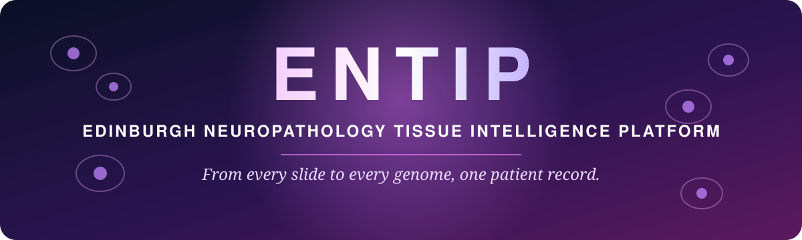

## AI models

**AI glioma workflow.** Six steps from H&E slides to a draft WHO CNS5 integrated diagnosis for a pathologist to sign off
([docs](docs/glioma-workflow/README.md)).

1. **Pre-training** (`training/.../embed/`): frozen H-optimus-0 tile embeddings, once per slide.
2. **Triage** (`training/.../triage/`): tumour? glial? enough tissue?
3. **High-grade features** (`training/.../highgrade/`): necrosis, microvascular proliferation, mitoses.
4. **Panel markers** (`training/.../panel/`): IDH, 1p/19q, ATRX, TP53, CDKN2A/B, EGFR and more.
5. **Methylation class** (`training/.../methylation/`): CNS methylation class from H&E.
6. **Integrated diagnosis** (`dx/`): WHO CNS5 rules engine and draft report.

## Platform

1. **Slide fork and link** (`fork/`): clinical and research copies of each WSI, joined by a linkage code.
2. **Live training** (`training/`): train any feature live, and retrain existing models.
3. **Spatial multi-omics** (`spatial/`): spatial genomics registered to H&E.
4. **Clinician GUI** (`gui/`): viewer and review for clinicians.
5. **Central database** (`db/`): one row per patient, linked to slides, assays and model outputs.

Research use only.
