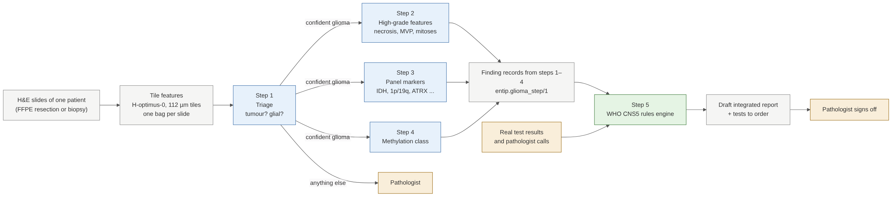

# AI glioma workflow

Five steps turn the H&E slides of one patient into a draft WHO CNS5 integrated diagnosis for a pathologist to
sign off. Steps 1 to 4 are AI models that each make one or more calls with a calibrated confidence. Step 5 is a
fixed rules engine. Any call that is not confident orders the real test (or a pathologist review) instead of
being used. Research use only; nothing has been run on real patients.

| Step | Question | Page | Code (branch, PR) |
|---|---|---|---|
| 1 | Is it tumour, and is the tumour glial? Is there enough tissue? | [step1-triage.md](step1-triage.md) | `training/src/entip_train/triage/` + shared `wsi/` (PR #14) |
| 2 | Necrosis, microvascular proliferation, mitotic activity | [step2-high-grade.md](step2-high-grade.md) | `training/src/entip_train/highgrade/` (PR #12) |
| 3 | Panel markers (IDH, 1p/19q, ATRX, TP53, CDKN2A, EGFR, +7/-10, TERT, H3, MGMT) | [step3-panel.md](step3-panel.md) | `training/src/entip_train/panel/` (PR #13) |
| 4 | Methylation class | [step4-methylation.md](step4-methylation.md) | `training/src/entip_train/methylation/` (PR #10) |
| 5 | Integrated diagnosis and report | [step5-integrated-diagnosis.md](step5-integrated-diagnosis.md) | `dx/` (PR #11) |

**Merge order.** Step 1 holds the shared slide pipeline (`wsi/`: tiles, H-optimus-0 bags, attention-MIL,
calibration, novelty check) that steps 2 to 4 import, so PR #14 goes first. Step 5 holds the shared output
contract (`dx/contract/`).

**Shared rules for every step**

- One record per finding, contract `entip.glioma_step/1` (`dx/contract/README.md`), posted to the database as a
  `glioma_step` event. Each record says the call, its calibrated confidence, the accept threshold, `confident`
  or `uncertain`, and the test to order when uncertain.
- A threshold is only accepted if the error among accepted calls stays under the agreed limit (default 5%) with
  95% confidence on held-out patients. At 5% that needs at least 59 error-free held-out patients.
- Age, site and radiology may be used as priors but never appear in a record or the report.
- Every model, library and dataset must be usable in the NHS; non-commercial items are research options only.

**Compute.** Turning slides into tile features (H-optimus-0) needs a GPU, once per slide. Everything after that
(training, calibration, prediction from saved features, the rules engine) runs on a CPU.

Diagrams: sources in `diagrams/*.mmd` (Mermaid); PNG and SVG are rendered from them.
