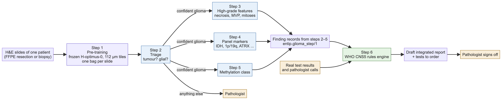

# AI glioma workflow

Six steps turn the H&E slides of one patient into a draft WHO CNS5 integrated diagnosis for a pathologist to
sign off. Step 1 runs the frozen foundation model (H-optimus-0) once per slide and saves its tile embeddings.
Steps 2 to 5 are AI models on those embeddings that each make one or more calls with a calibrated confidence.
Step 6 is a fixed rules engine. Any call that is not confident orders the real test (or a pathologist review)
instead of being used. Research use only; nothing has been run on real patients.

| Step | Question | Page | Code |
|---|---|---|---|
| 1 | Pre-training: turn each slide into frozen H-optimus-0 tile embeddings | [step1-pretraining.md](step1-pretraining.md) | `training/glioma/src/entip_glioma/embed/` + shared `wsi/bags.py` |
| 2 | Is it tumour, and is the tumour glial? Is there enough tissue? | [step2-triage.md](step2-triage.md) | `training/glioma/src/entip_glioma/triage/` + shared `wsi/` |
| 3 | High-grade features, in three sub-steps (shared rules) | [step3-high-grade.md](step3-high-grade.md) | `training/glioma/src/entip_glioma/highgrade/` |
| 3a | Microvascular proliferation | [step3a-mvp.md](step3a-mvp.md) | `highgrade/`, labels `training/runs/highgrade_labels/` |
| 3b | Necrosis | [step3b-necrosis.md](step3b-necrosis.md) | `highgrade/`, labels `training/runs/highgrade_labels/` |
| 3c | Mitotic activity | [step3c-mitosis.md](step3c-mitosis.md) | `highgrade/` with MitoEd candidates |
| 4 | Panel markers (IDH, 1p/19q, ATRX, TP53, CDKN2A, EGFR, +7/-10, TERT, H3, MGMT) | [step4-panel.md](step4-panel.md) | `training/glioma/src/entip_glioma/panel/` |
| 5 | Methylation class | [step5-methylation.md](step5-methylation.md) | `training/glioma/src/entip_glioma/methylation/` |
| 6 | Integrated diagnosis and report | [step6-integrated-diagnosis.md](step6-integrated-diagnosis.md) | `training/dx/` |

**Shared code.** Step 1 writes the bags (`wsi/bags.py`). Steps 2 to 5 share the rest of `wsi/` (attention-MIL,
calibration, novelty check). Step 6 holds the shared output contract (`training/dx/contract/`). Every step is on `main`.

**Shared rules for every step**

- One record per finding, contract `entip.glioma_step/1` (`training/dx/contract/README.md`), posted to the database as a
  `glioma_step` event. Each record says the call, its calibrated confidence, the accept threshold, `confident`
  or `uncertain`, and the test to order when uncertain.
- A threshold is only accepted if the error among accepted calls stays under the agreed limit (default 5%) with
  95% confidence on held-out patients. At 5% that needs at least 59 error-free held-out patients.
- Age, site and radiology may be used as priors but never appear in a record or the report.
- Every model, library and dataset must be usable in the NHS; non-commercial items are research options only.

**Compute.** Step 1 (H-optimus-0) needs a GPU, once per slide. Everything after that
(training, calibration, prediction from saved features, the rules engine) runs on a CPU.

Diagrams: sources in `diagrams/*.mmd` (Mermaid); PNG and SVG are rendered from them.
