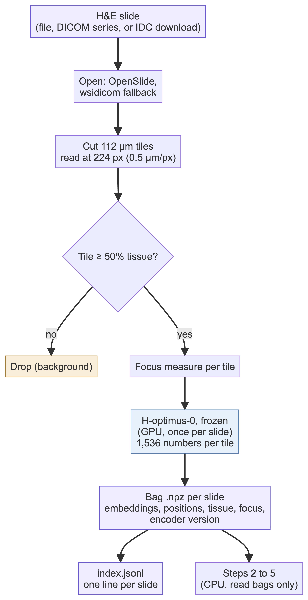
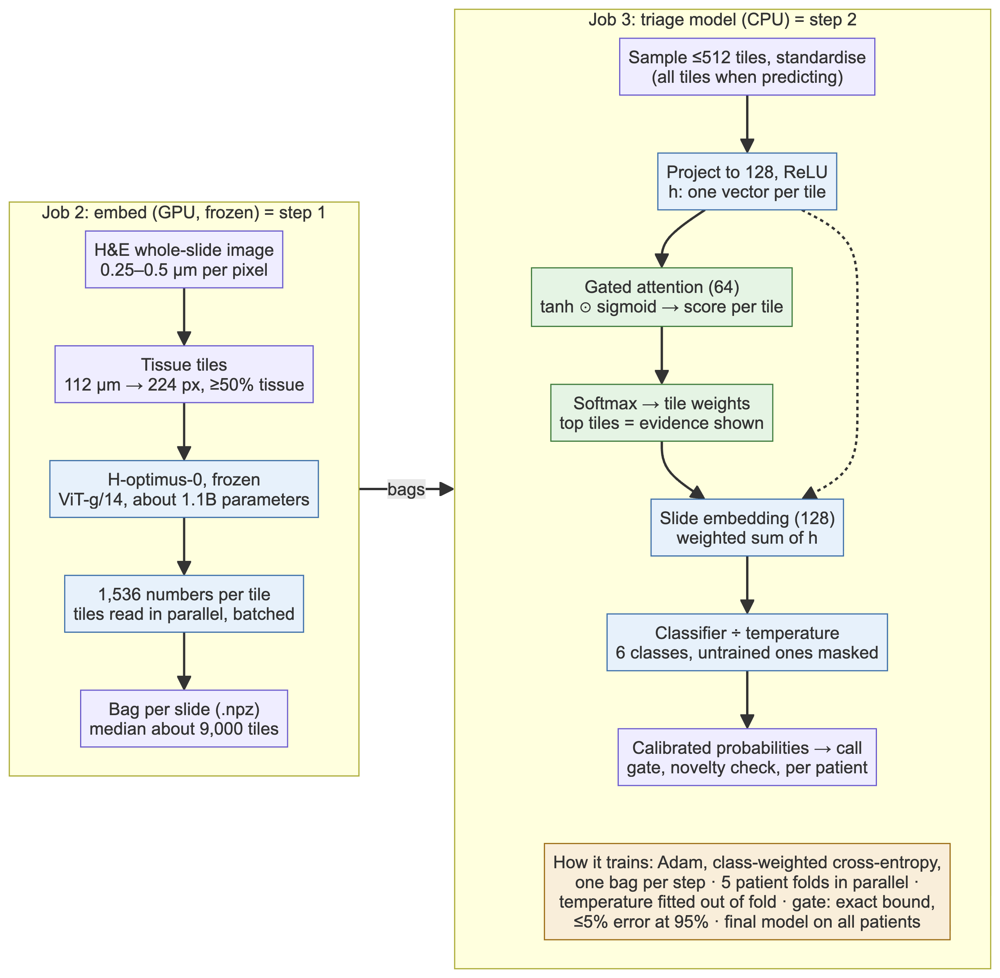

# Step 1: pre-training (frozen foundation model → tile bags)

[← workflow](README.md) · code `training/glioma/src/entip_glioma/embed/` and `wsi/bags.py` · command `entip-train embed`



Jobs 2 and 3 on Eddie, end to end (embedding, then the triage model and how it trains):



## What it does

This is the only step that runs the foundation model. Each H&E slide is cut into tissue tiles of a fixed
physical size, and every tile is embedded once with H-optimus-0 (ViT-g/14, 1,536 numbers per tile, Apache-2.0,
[model card](https://huggingface.co/bioptimus/H-optimus-0)). The result is one **bag** per slide: the tile
embeddings, where each tile sits, how much of it is tissue, and how sharp it is. Steps 2 to 5 train and
predict from these bags only, so they never read a slide or touch the foundation model.

The foundation model is used frozen: no fine-tuning and no further pre-training on Edinburgh slides. Any change
to it changes every embedding, so each bag records its encoder version and the later steps refuse bags from a
different one.

## Inputs and outputs

- **In:** H&E whole-slide images (any OpenSlide format, or a DICOM series; IDC slides are downloaded one at a
  time from a manifest).
- **Out:** `<scan_id>.npz` per slide (`wsi.bags.Bag`, saved without pickles so loading one cannot run code), and
  one line per slide in `index.jsonl` (encoder, tile size, pixel size, tile count). Failures go to
  `failed.jsonl`.

## How it works

1. Open the slide (OpenSlide; wsidicom for DICOM series OpenSlide cannot read, such as JPEG 2000 with
   YBR_FULL_422 colour).
2. Cut 112 µm tiles, read at 224 px whatever the scanner's pixel size (0.5 µm/px, the input H-optimus-0 was
   trained on), with antialiased resizing.
3. Keep tiles that are at least half tissue (saturation and brightness on a small preview), and give each a
   focus measure. Pen marks and folds need HistoQC upstream.
4. Embed each kept tile with the frozen H-optimus-0 and save the bag.

```bash
pip install -e platform/live-training -e "training/glioma[slides,foundation]"   # add [idc] for build-bags
entip-train embed extract slide.svs --out bags/                                  # slides already on disk
entip-train embed build-bags --manifest manifest.csv --out bags/ --per-class 5   # IDC trial: 5 slides per source
entip-train embed build-bags --manifest manifest.csv --out bags/                 # everything; stop and rerun freely
```

`build-bags` downloads one slide, embeds it, saves the bag and deletes the slide, so the 3.3 TB of the FFPE +
GTEx manifest never sits on disk. It skips slides already done. The old `entip-train triage extract` and
`triage build-bags` commands still work and do the same thing.

## Compute

H-optimus-0 needs a GPU (or Apple MPS), once per slide. Everything after this step runs on a CPU. A bag is about
3 MB per slide when training keeps 1,024 tiles as float16. The `handcrafted` encoder (colour and texture,
no weights) is for tests and the synthetic demos only.

## Status and open items

- Checked end to end on seven public slides from five sources with the `handcrafted` test encoder.
- H-optimus-0 itself has not been run yet: the cloud sessions cannot reach Hugging Face. The Eddie GPU trial is
  pending.
- A smaller student distilled from H-optimus-0 (`entip-glioma distill`, [training/runs/distill/](../../training/runs/distill/README.md))
  can embed new slides without a large GPU, once it is shown to match the teacher on each step.
- Domain-adaptive pre-training on Edinburgh slides is out of scope for now. It would need a GPU cluster, real
  slides and a full re-embed, and it would mean revalidating every later step.
