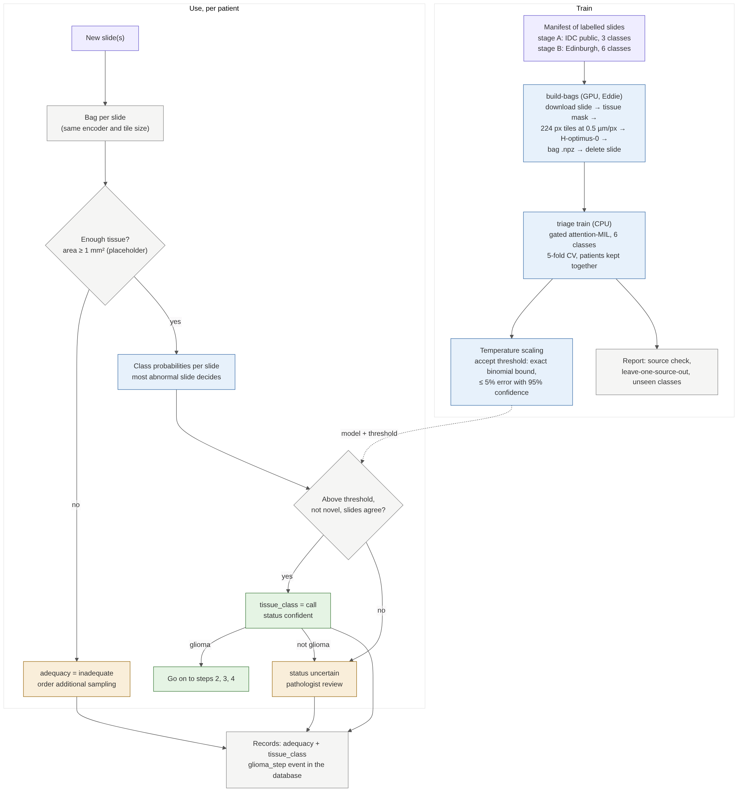

# Step 1: triage (tumour? glial? enough tissue?)

[← workflow](README.md) · code `training/src/entip_train/triage/` and `wsi/` · PR #14 (branch `claude/project-thread-6u7wis`)



## What it does

One attention-MIL model reads every tile of a patient's H&E slides and gives six classes: `normal_brain`,
`reactive`, `glioma`, `other_primary_cns`, `metastasis`, `lymphoma`. Tumour and glial probabilities are sums of
those. With several slides, the most abnormal one decides. Only a confident glioma call goes on to steps 2 to
4; everything else goes to a pathologist.

## Inputs and outputs

- **In:** FFPE H&E slides (resections and biopsies; frozen sections are a later, separate model).
- **Out:** two records, `adequacy` (tissue area; 1 mm² is a placeholder) and `tissue_class` (call, calibrated
  confidence, threshold, status, probabilities, top attention tiles as evidence), plus regions and predictions
  in the database.

## How it is trained

1. `triage manifest` lists labelled slides (stage A: public IDC data, 3 classes, 3,472 slides; stage B:
   Edinburgh, all 6 classes).
2. `triage build-bags` (GPU): download a slide, find tissue, cut 224 px tiles at 0.5 µm/px (112 µm), embed with
   H-optimus-0, save one `.npz` bag, delete the slide. Restartable.
3. `triage train` (CPU): gated attention-MIL (Ilse et al. 2018), 5-fold cross-validation with each patient's
   slides kept together, temperature scaling, then the accept threshold by an exact binomial bound.
4. The report includes a source check and leave-one-source-out runs, because each public source holds one class.

```bash
entip-train triage demo                     # synthetic, CPU, seconds
entip-train triage build-bags --manifest stage_a_all.csv --out bags/ --per-class 5   # trial
entip-train triage train --manifest stage_a_train.csv --bags bags/ --out models/triage
entip-train triage predict bags/<scan>.npz --model models/triage --study-id SYN-0001 --db http://localhost:8000
```

Eddie jobs and the stage A dataset: project files `etip/datasets/triage/stage_a/` (`eddie_build_bags.sh` GPU,
`eddie_train.sh` CPU, README).

## Status and open items

- Tested on 7 real public slides with a test encoder; H-optimus-0 not yet run (Eddie trial pending).
- Every stage A slide was scanned on a Leica scanner; more scanners and classes are listed in the design doc.
- Metastasis, lymphoma and reactive need Edinburgh (or BRAIN UK) slides.
- To decide: adequacy area, treatment-effect and neurocytoma classes, error limit per class.
