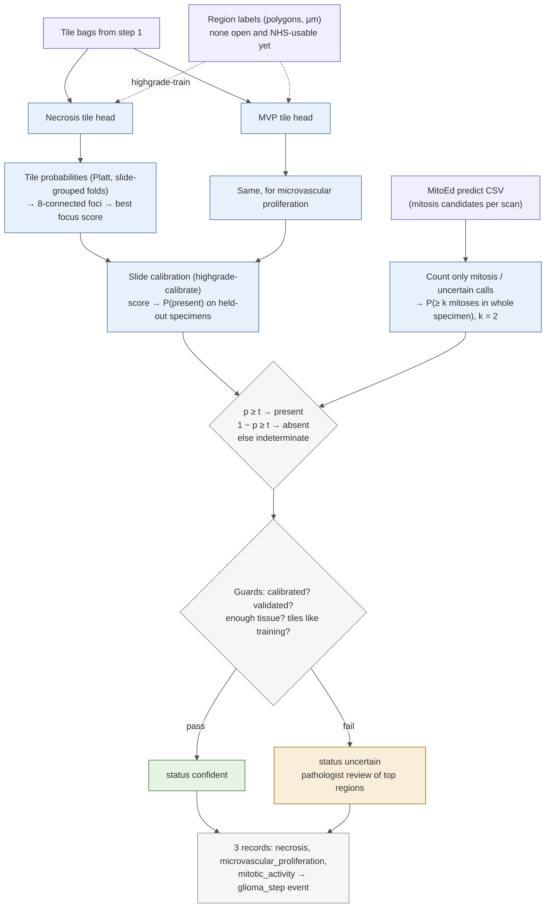

# Step 2: high-grade features (necrosis, microvascular proliferation, mitoses)

[← workflow](README.md) · code `training/src/entip_train/highgrade/` · PR #12 (branch `claude/project-thread-x3eukx`)



## What it does

Three detectors, each giving one record with `present`, `absent` or `indeterminate`:

| Finding | How |
|---|---|
| `necrosis` | Tile head on the step 1 bags → tile probabilities → connected foci → best focus score → slide-calibrated P(present) |
| `microvascular_proliferation` | Same machinery, its own head |
| `mitotic_activity` | MitoEd candidates (only those MitoEd calls mitosis or uncertain) → P(at least k mitoses in the whole specimen), k = 2 by default |

The mitotic cut-off follows cIMPACT-NOW update 5, which says no validated cut-off exists and that most
neuropathologists use at least 2 mitoses in the whole specimen, or 1 in a very small biopsy
([Brat et al. 2020](https://doi.org/10.1007/s00401-020-02127-9)). It is a setting, not a validated value.

## Guards

A call is `uncertain` with a pathologist review of the top regions when the slide score is not calibrated, the
model is not signed off (`validated=False`, the default), there are too few tissue tiles, or too many tiles are
unlike training. A different encoder or tile size is refused.

```bash
entip-train highgrade-demo
entip-train highgrade-train --feature necrosis --bag s1.npz --labels s1.json --out necrosis.joblib
entip-train highgrade-calibrate --head necrosis.joblib --specimens held_out.json
entip-train highgrade --study-id SYN-0001 --bag s1.npz --head necrosis.joblib --head mvp.joblib \
    --mitoed-cells SCN-0001-A1-01=cells.csv --db http://127.0.0.1:8705
```

## Status and open items

- Synthetic only. No head trained on real tissue.
- No open, NHS-usable region labels for necrosis or MVP in brain: BraTS-Path is CC BY-NC and Ivy GAP is under
  Allen non-commercial terms. Edinburgh pathologist outlines are the likely source.
- MitoEd has not been run on CNS tumours (its training data, MIDOG++, has no brain).
