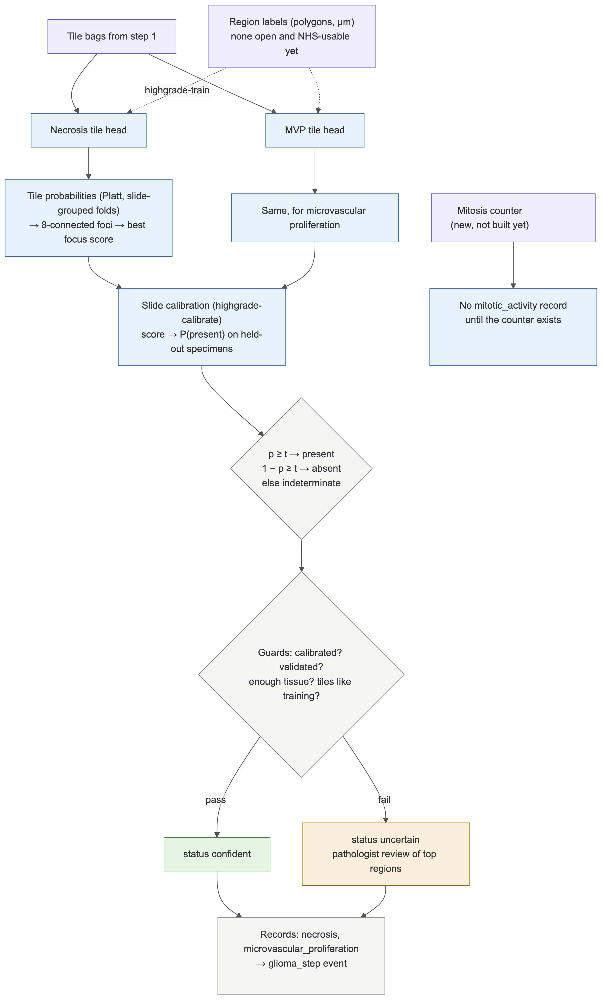

# Step 3: high-grade features

[← workflow](README.md) · code `training/glioma/src/entip_glioma/highgrade/` · PR #12 (branch `claude/project-thread-x3eukx`)



Three separate sub-steps, one finding each. They share the code, the call rules and the guards below, but each
has its own unit of decision, labels, look-alikes and validation.

| Sub-step | Finding | Unit the pathologist decides on | Page |
|---|---|---|---|
| 3a | `microvascular_proliferation` | One vessel, at high magnification | [step3a-mvp.md](step3a-mvp.md) |
| 3b | `necrosis` | An area, with its edge, at low to medium magnification | [step3b-necrosis.md](step3b-necrosis.md) |
| 3c | `mitotic_activity` | One cell, counted over the whole specimen | [step3c-mitosis.md](step3c-mitosis.md) |

## Where these findings change the diagnosis

- **IDH-wildtype:** TERT, EGFR amplification or +7/−10 already makes a glioblastoma (cIMPACT-NOW 3). Necrosis
  and MVP rarely change the answer there.
- **IDH-mutant astrocytoma:** necrosis or MVP (or CDKN2A/B homozygous deletion) makes grade 4; significant
  mitoses make grade 3 ([Brat et al. 2020](https://doi.org/10.1007/s00401-020-02127-9)).
- **Oligodendroglioma:** MVP, necrosis and brisk mitoses all point to grade 3.
- **Small biopsies:** one focus can decide.

So each sub-step has to find **a single focus**, in **a lower-grade background**. Almost every positive in TCGA is
a glioblastoma, so a model can learn "this is a glioblastoma" instead of the feature. Each sub-step reports its
slide-level sensitivity separately for IDH-mutant cases.

## Shared to all three

Each of 3a and 3b gives one `entip.glioma_step/1` record: `present`, `absent` or `indeterminate`. 3c is being
redesigned as a count and makes no record for now.

- **Call.** With p = P(present) and threshold t: `present` if p ≥ t, `absent` if 1 − p ≥ t, else `indeterminate`.
- **Slide call from foci, not tiles.** A slide has about 50,000 tiles, so even 1 false tile in 10,000 gives 5 a
  slide. The slide score comes from the best focus (3a, 3b), and is calibrated on
  held-out specimens whose truth comes from a pathologist's review of the whole slide (`highgrade-calibrate`).
- **Guards.** The call is `uncertain`, with a pathologist review of the top regions, when the slide score is not
  calibrated, the model is not signed off (`validated=False`, the default), there are too few tissue tiles, or
  too many tiles are unlike training. A different encoder or tile size is refused.
- **Assistive first.** The output shows the top candidate foci for each finding. A pathologist confirming a short,
  sensitive list is easier to validate than an autonomous call.
- **Labels are our own.** BraTS-Path (CC BY-NC) and Ivy GAP (Allen non-commercial) never train or pick tiles for
  these heads. Labels are made in-house on CC BY slides (TCGA, CPTAC via IDC), by one training module per
  sub-step (`training/runs/highgrade_mvp/`, `highgrade_necrosis/`, sharing `highgrade_common/`).
- **Free negatives.** Under the grading TCGA used, grade 3 astrocytic and grade 2 gliomas had no necrosis or MVP, so
  their slides give negatives for 3a and 3b without labelling. A pathologist checks their tiles by eye first, as a
  grid, and audit picks and the export check them again.

```bash
entip-train highgrade-demo
entip-train highgrade-train --feature necrosis --bag s1.npz --labels s1.json --out necrosis.joblib
entip-train highgrade-calibrate --head necrosis.joblib --specimens held_out.json
entip-train highgrade --study-id SYN-0001 --bag s1.npz --head necrosis.joblib --head mvp.joblib \
    --db http://127.0.0.1:8705
```

## Status

3a and 3b have their own training modules. 3c has no detector yet ([design](step3c-mitosis.md)).
