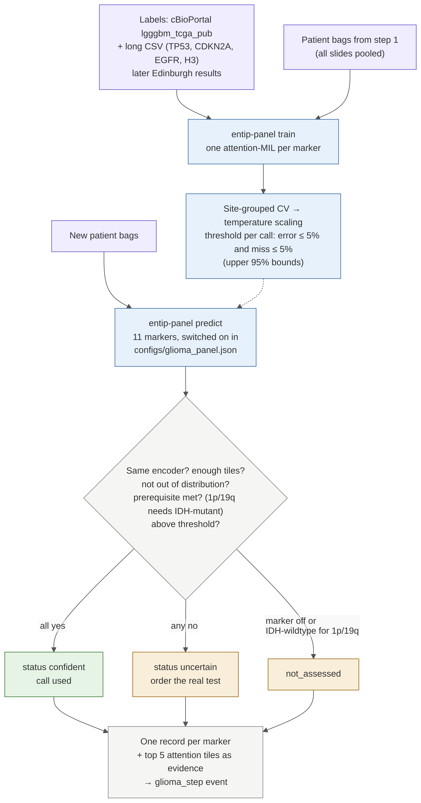

# Step 3: glioma panel markers from H&E

[← workflow](README.md) · code `training/src/entip_train/panel/`, doc `training/PANEL.md` · PR #13 (branch `claude/project-thread-eg24j4`)



## What it does

One attention-MIL model per marker, on all of a patient's slides pooled: `IDH`, `ATRX`, `TP53`, `1p19q`,
`CDKN2A`, `EGFR`, `chr7_chr10`, `TERT`, `H3K27`, `H3G34`, `MGMT`. Which markers run is set in
`training/configs/glioma_panel.json`, since Edinburgh's panel list is not confirmed. A call is used only if it
passes every gate; otherwise the record orders the real test.

## Gates

- Same encoder and tile size as training, enough tissue tiles, bag not out of distribution.
- Prerequisite met: 1p/19q only when IDH-mutant (from a real result or a confident IDH call).
- Confidence at or above the threshold for that call. Thresholds come from cross-validation that keeps each
  TCGA tissue source site in one fold, and need both the wrong-call rate and the miss rate under 5% (upper 95%
  bounds). So a negative call needs at least 59 altered patients seen with none missed.

```bash
entip-panel demo
entip-panel labels --cbioportal lgggbm_tcga_pub_samples.tsv --long tcga_extra_labels.csv --out labels.json
entip-panel train --bags bags/ --labels labels.json --out models/panel-0.2.0
entip-panel predict --model models/panel-0.2.0 --bags new_bags/ --scan-map scans.csv --db http://127.0.0.1:8705
```

## Training data (TCGA, patients with an FFPE diagnostic slide)

Altered / not altered: IDH 421/381; 1p/19q codel 162 (non-codel 256); ATRX 189/471; TERT 150/151; MGMT
methylated 520/213; +7/-10 311/548; CDKN2A homdel 266 of 859; EGFR amp 208 of 859; TP53 309 of 729. Too few for
H3 K27M (1), H3 G34 (3) and BRAF V600E (2), so those stay "order the test".

## Status and open items

- Synthetic only. Labels for TP53, CDKN2A, EGFR and H3 still to build from TCGA mutation and copy-number files.
- TCGA gives ATRX and TP53 mutation, while the panel uses IHC: Edinburgh IHC results would be the right labels.
- Needs an untouched test set (Edinburgh) before any real use.
