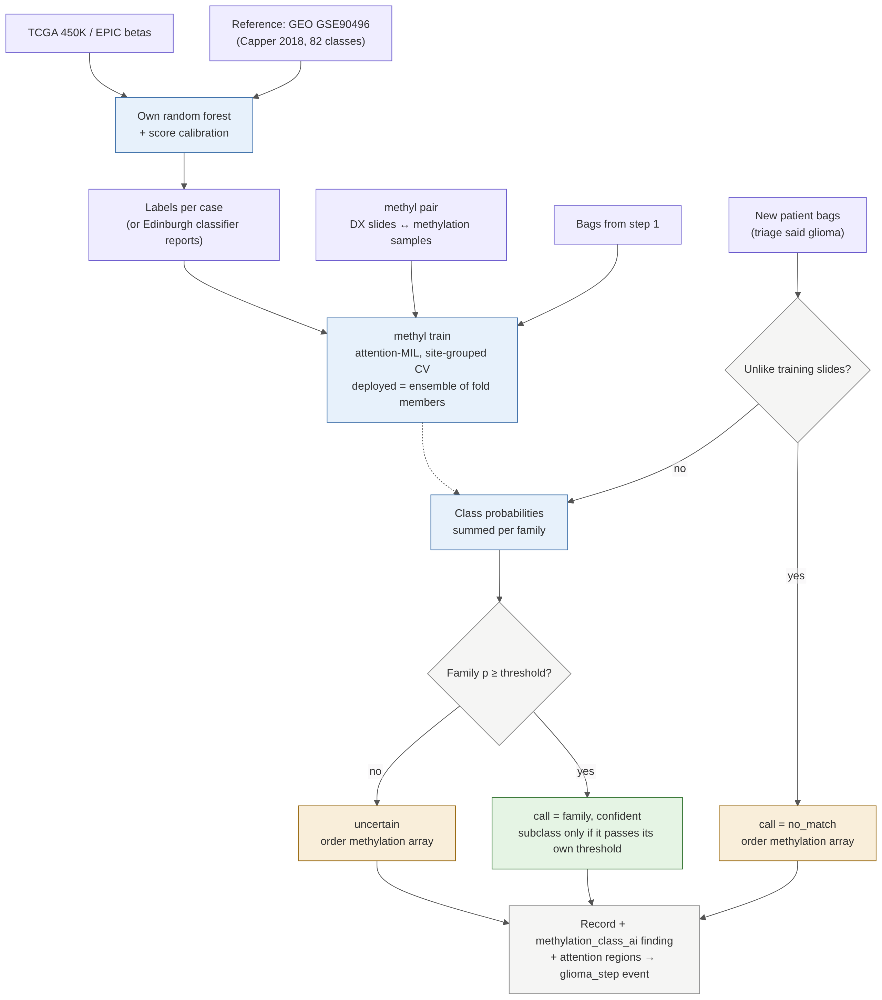

# Step 4: methylation class from H&E

[← workflow](README.md) · code `training/src/entip_train/methylation/`, doc `training/methylation.md` · PR #10 (branch `claude/project-thread-fo3ivf`)



## What it does

Predicts the methylation family (and subclass when confident) from the H&E slides, and orders the methylation
array whenever it is not confident. Slides unlike anything in training get `no_match`, as a methylation
classifier would. Runs only when triage says glioma.

## How it is trained

1. **Labels:** our own random forest (with score calibration) trained on the GEO GSE90496 reference cohort
   (Capper et al. 2018, 2,682 tumours, 82 classes) and applied to TCGA 450K / EPIC betas. For Edinburgh, the
   classifier reports could be used directly.
2. **Pairs:** TCGA diagnostic slides matched to methylation samples (`methyl pair`, using the GDC sample sheet).
   545 TCGA patients have a 450K array and an FFPE diagnostic slide.
3. **Model:** attention-MIL with cross-validation grouped by TCGA tissue source site; the deployed model is the
   ensemble of fold members. Thresholds use the same exact bound at 5% error.

```bash
entip-train methyl demo
entip-train methyl pair --slides dx_slides.txt --methylation meth450k.txt --methylation-sheet gdc_sample_sheet.tsv --out pairs.csv
entip-train methyl label --ref-betas ref/ --ref-labels ref_labels.csv --target-betas tcga/ --target-sheet gdc_sample_sheet.tsv --out labels.csv
entip-train methyl train --labels labels.csv --pairs pairs.csv --bags bags/ --out models/mc-0.1.0
entip-train methyl predict --model models/mc-0.1.0 --bags SCN-1.npz --study-id SYN-0001 --db http://127.0.0.1:8705
```

## Status and open items

- Synthetic only.
- TCGA DNA came from a frozen portion, not the FFPE slide, so expect label noise in mixed tumours.
- GSE90496 data-use terms not checked.
- Does Edinburgh keep IDATs or only classifier reports?
- Family mapping of each class needs a neuropathologist's check.
- Benchmark: Hetairos (Nature Cancer 2026) predicts 102 methylation classes from H&E.
