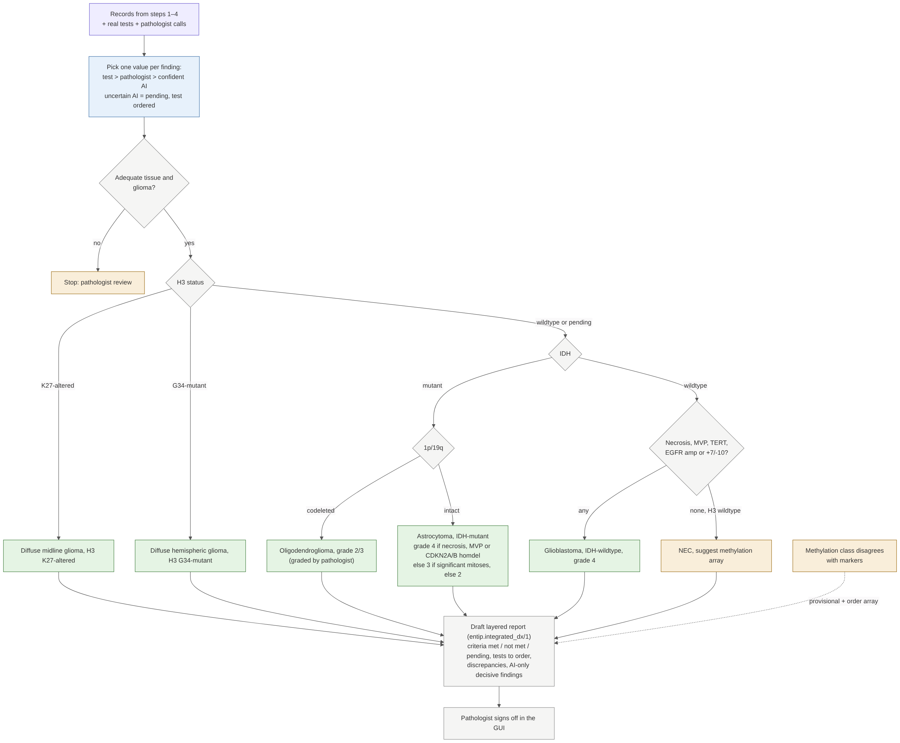

# Step 5: WHO CNS5 integrated diagnosis

[← workflow](README.md) · code `dx/` (`entip-dx`), contract `dx/contract/` · PR #11 (branch `claude/project-thread-o3tsg0`)



## What it does

A fixed rules engine: no learning. It reads the records from steps 1 to 4 plus real test results and
pathologist calls, works out the integrated diagnosis, orders the tests still needed, and writes a draft
layered report (`entip.integrated_dx/1`) for the pathologist to sign off in the GUI. Every call traces to a
written criterion with its source.

## Rules in brief

- One value per finding: a real test beats a pathologist's call, which beats a confident AI call. An
  uncertain AI call is "pending" and its test is ordered.
- Inadequate tissue or a non-glioma triage call stops the glioma rules.
- H3 K27-altered → diffuse midline glioma; H3 G34-mutant → diffuse hemispheric glioma.
- IDH-mutant + 1p/19q codeleted → oligodendroglioma; IDH-mutant, not codeleted → astrocytoma, grade 4 with
  necrosis, MVP or CDKN2A/B homozygous deletion, else 3 with significant mitoses, else 2 (cIMPACT-NOW 5).
- IDH-wildtype, H3-wildtype with necrosis, MVP, TERT, EGFR amplification or +7/-10 → glioblastoma, grade 4
  (cIMPACT-NOW 3); none of these → NEC, methylation array suggested.
- AI-only calls that define the type or grade get their real test ordered, and the draft stays provisional.
- A methylation class that disagrees with the markers makes the draft provisional.
- Negative R132H IHC alone is not IDH-wildtype: sequencing is ordered (except the age ≥ 55 prior rule, unchecked).

```bash
entip-dx diagnose records.json --text
entip-dx from-db SYN-0001 --post --text
entip-dx validate records.jsonl
```

## Sources and open items

Louis et al. 2021 (WHO CNS5 summary, tables), cIMPACT-NOW 3 and 5 (full text read), cIMPACT-NOW 1. Not yet
checked against a primary text: CDKN2A/B in grade 3 oligodendroglioma, grade 4 for paediatric-type H3-wildtype
IDH-wildtype HGG, and the age-55 exception. Other CNS tumour families go to pathologist review.
